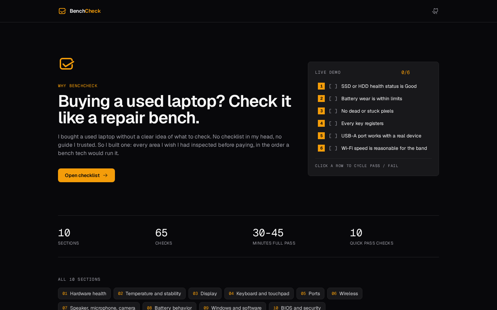
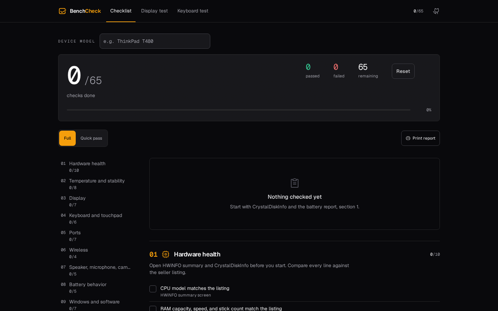

# BenchCheck

BenchCheck is a structured inspection checklist for anyone buying a used laptop in
person. You meet the seller, open it on a phone or on the machine itself, and work
through ordered checks so defects surface before money changes hands. A full pass
covers 65 items in ten sections; a 10-check quick pass fits when time is tight, and
the display and keyboard tests use the laptop under inspection as the rig.

It is built for the inspection moment, not for browsing specs afterwards: no
account, no uploads, and no network dependency for the checks themselves.



The landing screen leads with the situation a buyer is in, then shows the shape of
a full pass: 10 sections, 65 checks, and 30 to 45 minutes.

## What you can do

- Work through the full 65-check inspection across ten sections, from hardware
  health and temperature stability to the keyboard and touchpad, when you have
  30 to 45 minutes at the seller's table.
- Switch to the 10-check quick pass when time is short; it follows the priority
  order baked into one item per section, so the checks most likely to reveal a
  costly defect come first.
- Cycle each item from pending to pass to fail and attach a short reason to any
  failure, so a buyer can point at a specific defect instead of a general
  impression.



This is the same URL as the landing screen, reached by clicking "Open checklist":
the Inspection checklist heading, DEVICE MODEL field, 0/65 counter, Full and Quick
pass toggle, section bands, and a "Nothing checked yet" panel.

- See the finished unit graded A through F by fail count once every check is done,
  on a rubber-stamp seal in the summary bar.
- Run the display test fullscreen on the machine under inspection and step through
  white, black, red, green and blue surfaces to spot dead pixels or backlight
  bleed.
- Use a ThinkPad-layout keyboard and touchpad test on that same machine; keys light
  up as you press them and a counter tracks what has registered.
- Print a one-page failure report from the browser when the inspection ends,
  listing the failed items and their reasons.

The checks expect the buyer to have the seller's machine powered on and to open
vendor tools on it where a reading is needed: HWiNFO, CrystalDiskInfo,
`powercfg /batteryreport`, Cinebench, Device Manager and BIOS. The app supplies the
order and the record, not the measurements themselves.

## How it works

BenchCheck is a single-page app built with React 19, TypeScript and Vite, styled
with Tailwind CSS, and bundled with Bun. nginx serves the built files as static
assets on port 8080 with a fallback that sends every path to the same entry HTML.
The unusual part is what is missing: there is no router, no backend and no data
fetch. The four screens are tab state inside one component, the checklist content
is authored as data in `src/data/checklist.ts`, and all progress stays in the
browser.

## Running it

From a checkout, install from the lockfile and start the dev server:

```bash
bun install --frozen-lockfile
bun run dev
```

The dev server listens on port 5173. `bun run build` type-checks with `tsc -b` and
writes `dist/`; `bun run lint` runs oxlint.

## Limitations

- Progress lives only in this browser's localStorage on the device where you ran
  the inspection. Move to another machine or clear browser data and it is gone;
  nothing is uploaded or shared.
- There are no deep links. The checklist, display test and keyboard test are tabs
  at the same URL, so you reach them by clicking, not by address.
- Checklist wording and the 65-item count are product content authored in
  `src/data/checklist.ts`, not independently verified hardware facts. The final
  wording was still an open product decision at time of writing.
- The `README.md` that preceded this one was unedited Vite starter text describing
  a template, not BenchCheck. `PRODUCT.md` is the authoritative product brief.
- The display and keyboard tests need real interaction with the machine, so a
  static screenshot cannot confirm that either test behaves correctly.

Developer notes, exact versions, the browser-only data model, and operational
risks are in [TECHNICAL.md](TECHNICAL.md).
